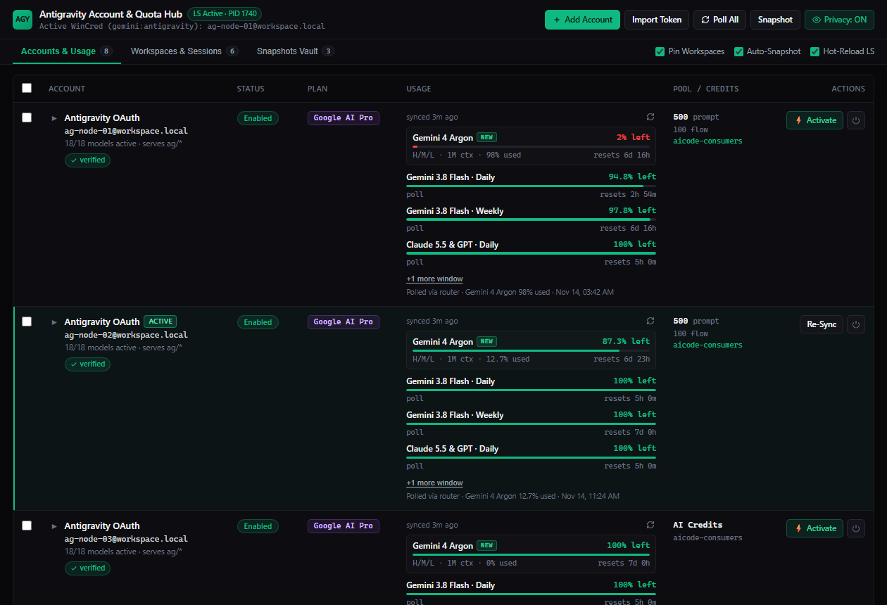
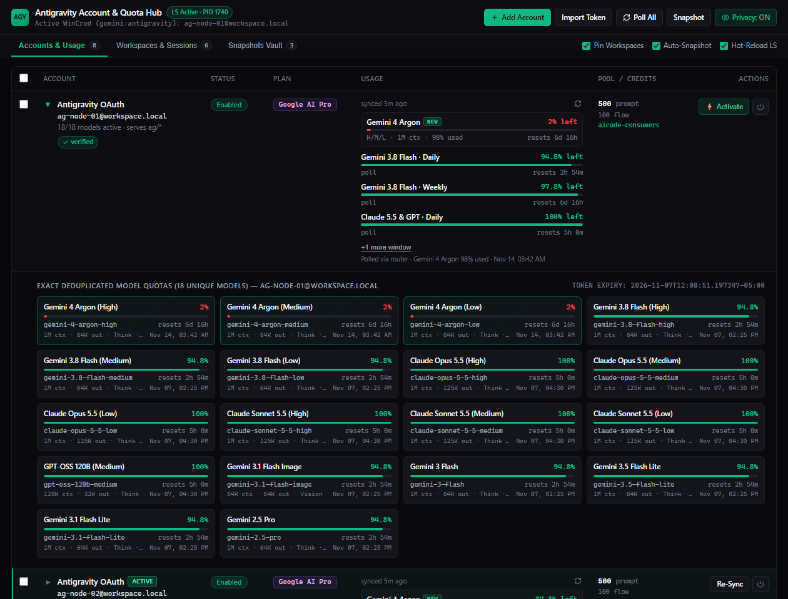
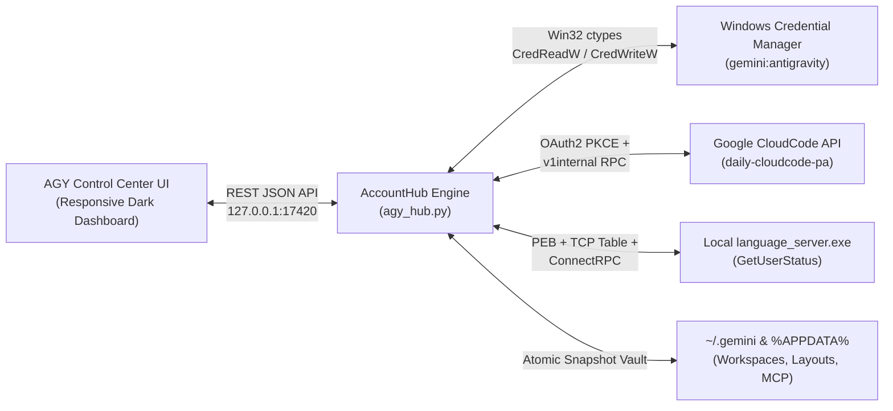

# AGY Control Center — Multi-Account & Quota Router for Antigravity

[](./.github/workflows/ci.yml)
[-3b82f6?style=flat-square&logo=windows&logoColor=white)](#architecture)
[-a855f7?style=flat-square&logo=python&logoColor=white)](#quick-start)
[](./LICENSE)

**AGY Control Center** is a zero-dependency, native Win32 multi-account OAuth manager, real-time **Gemini 4 Argon** & multi-model quota telemetry router, and workspace/session snapshot vault for Google Antigravity IDE.



---

## Key Capabilities

### 1. Real-Time Gemini 4 Argon & Multi-Model Quota Telemetry (Active + Inactive Accounts)
- **Direct CloudCode v1internal Protocol**: Queries `loadCodeAssist`, `retrieveUserQuotaSummary`, and `fetchAvailableModels` directly using the native Antigravity LanguageServer wire signature (`antigravity/hub/2.28.2` + `{"project": "aicode-consumers"}`).
- **Flagship Gemini 4 Argon Tracking**: Surfaces live `Gemini 4 Argon (High / Medium / Low)` remaining percentage (with `0.1%` precision), used percentage, `1M context · 64K output · Thinking + Vision` specs, rolling countdown timer, and exact local reset timestamp across **every connected account** — even accounts not currently logged into the IDE.
- **Zero-Duplicate 18-Model Catalog**: Automatically strips server-side rerouted legacy aliases (`gemini-2.5-flash`, `gemini-2.5-flash-lite`, `gemini-2.5-flash-thinking`, internal chat/tab preview keys) so each account displays the exact **18 canonical models** with zero duplicates:
  - `Gemini 4 Argon (High)`, `Gemini 4 Argon (Medium)`, `Gemini 4 Argon (Low)`
  - `Gemini 3.8 Flash (High)`, `Gemini 3.8 Flash (Medium)`, `Gemini 3.8 Flash (Low)`
  - `Claude Opus 5.5 (High)`, `Claude Opus 5.5 (Medium)`, `Claude Opus 5.5 (Low)`
  - `Claude Sonnet 5.5 (High)`, `Claude Sonnet 5.5 (Medium)`, `Claude Sonnet 5.5 (Low)`
  - `GPT-OSS 120B (Medium)`
  - `Gemini 3.1 Flash Image`, `Gemini 3 Flash`, `Gemini 3.5 Flash Lite`, `Gemini 3.1 Flash Lite`, `Gemini 2.5 Pro`



### 2. Instant WinCred Hot-Swap Without Losing Workspaces or Sessions
- **Direct `advapi32.dll` Credential Bridge**: Reads and writes the `gemini:antigravity` generic credential blob in Windows Credential Manager in-memory via `CredReadW` / `CredWriteW`.
- **Workspace & Layout Pinning**: Updates `jetski.onboarding.lastLoginUsername` inside `%APPDATA%\Antigravity\app_storage.json` while preserving all multi-conversation window layouts (`antigravity-multi-conversation-layout*`), `~/.gemini/config/projects/*.json` workspaces, and SQLite conversation history (`conversation_summaries.db`).
- **Optional Hot-Reload Language Server**: Terminates `language_server.exe` via Win32 `TerminateProcess` so the Electron host automatically respawns it within 2 seconds under the newly activated OAuth credential.

### 3. 100% In-Process Win32 `ctypes` Discovery (Zero Console Popups)
- Discovers `language_server.exe` PID, PEB command-line `--csrf_token`, and IPv4 listening TCP ports in `<1ms` using pure Win32 APIs (`CreateToolhelp32Snapshot`, `NtQueryInformationProcess`, `ReadProcessMemory`, and `GetExtendedTcpTable`).
- Spawns **zero** PowerShell or `cmd.exe` subprocesses during background polling — eliminating terminal window flashes completely.

### 4. Built-In Streamer / Privacy Mode & Atomic Persistence
- **1-Click Privacy Mode**: Click **Privacy** in the top bar (or append `?privacy=1`) to mask all email addresses, personal display names, and WinCred banners into synthetic node aliases (`ag-node-01@workspace.local`).
- **Atomic File Writes**: All credential and token refreshes write through temporary `.tmp` files with automatic `accounts.json.bak` failover recovery.

---

## Architecture



---

## Quick Start

### Prerequisites
- **OS**: Windows 10 or Windows 11 (x64)
- **Python**: Python 3.10+ (uses 100% Python standard library + `ctypes` — no `pip install` required)

### Launch the Desktop App (Zero Console Window)
Double-click **`Launch_AGY_Hub.bat`** (or **`Launch_AGY_Hub.vbs`**), or run from a terminal:

```powershell
python agy_hub.py
```

To start the background telemetry server without opening a GUI window:

```powershell
pythonw agy_hub.py --no-window
```

Then open **`http://127.0.0.1:17420/`** in any browser.

---

## Adding & Switching Accounts

1. **Auto-Import Active IDE Account**: On first launch, AGY Control Center automatically reads your active `gemini:antigravity` credential from Windows Credential Manager and imports it into the pool.
2. **Add Google Account (OAuth2 PKCE)**: Click **`+ Add Account`** in the top bar and pick one of:
   - **Sign in with this PC's browser** — opens Google's consent screen in the default browser and completes automatically on `http://localhost:17420/auth/callback`.
   - **Get a sign-in link** — generates the same OAuth link without opening anything. Copy it, open it, or send it to another browser, profile or device. After signing in there, the browser lands on an address starting with `http://localhost:17420/auth/callback?...` (the page itself will not load on another device — that is expected). Paste that full address, or just the `code`, back into the dialog to finish. Links are single-use and expire after 15 minutes.
3. **Import Refresh Token**: Click **`Import Token`** to paste an existing `1//0g...` refresh token or a full `gemini:antigravity` JSON credential blob.
4. **Hot-Swap Active Account**: Click **`⚡ Activate`** on any row to switch the active IDE account while keeping all open projects, window layouts, and agent conversations intact.

---

## Repository Structure

```text
agy_hub/
├── agy_hub.py                  # Core Win32 ctypes bridge, OAuth PKCE server, CloudCode & ConnectRPC router
├── static/
│   ├── index.html              # Dashboard markup (Privacy Mode, model drawer, Add Account dialog)
│   ├── app.css                 # Dark theme & responsive layout
│   └── app.js                  # Dashboard logic (plain JS, no dependencies)
├── tests/
│   └── test_smoke.py           # Stdlib-only smoke tests (python -I tests/test_smoke.py)
├── assets/
│   ├── dashboard-preview.png   # Main dashboard screenshot (Privacy Mode enabled)
│   └── models-drawer-preview.png # 18-model deduplicated telemetry drawer screenshot
├── data/
│   └── accounts.example.json   # Sanitized example account schema (real accounts.json is gitignored)
├── .github/
│   └── workflows/
│       └── ci.yml              # GitHub Actions CI (syntax, privacy leak gate, unit tests)
├── Launch_AGY_Hub.bat          # One-click Windows launcher
├── Launch_AGY_Hub.vbs          # Windowless VBScript process launcher
├── .gitignore                  # Strict exclusion rules for local tokens and snapshots
└── LICENSE                     # MIT License
```

---

## REST API Reference

| Endpoint | Method | Description |
|---|---|---|
| `/api/state` | `GET` | Returns enriched accounts, active WinCred email, `language_server.exe` status, pinned workspaces, and snapshots |
| `/api/accounts/refresh` | `POST` | Polls live CloudCode + ConnectRPC telemetry for one (`{"accountId": "..."}`), several (`{"accountIds": [...]}`) or all (`{}`) accounts in parallel |
| `/api/accounts` | `GET` | Lightweight accounts + sync status (used for in-place UI refresh) |
| `/api/accounts/add-oauth` | `POST` | Starts a Google OAuth2 PKCE login flow and returns `authUrl` + `state`. `{"openBrowser": false}` only generates the link |
| `/api/accounts/add-oauth/complete` | `POST` | Finishes a link sign-in from the pasted redirect URL or code (`{"state": "...", "input": "..."}`) |
| `/api/accounts/add-oauth/cancel` | `POST` | Cancels a pending sign-in link |
| `/api/accounts/import-token` | `POST` | Imports an account from a raw OAuth `refreshToken` and polls its model quotas |
| `/api/accounts/switch` | `POST` | Hot-swaps `gemini:antigravity` in WinCred, pins workspace layouts, and optionally restarts `language_server.exe` |
| `/api/accounts/remove` | `POST` | Removes an account from the local pool |
| `/api/snapshots/create` | `POST` | Archives `config.json`, `mcp_config.json`, `app_storage.json`, `antigravity_state.pbtxt`, and `projects/*.json` |
| `/api/snapshots/restore` | `POST` | Restores a workspace/layout snapshot while preserving the currently active OAuth login |

---

## Sync Behaviour
- **Auto-refresh**: the hub re-polls every account in the background (default every 2 minutes; change or turn it off with the **Auto-refresh** selector). The page updates in place without reloading.
- **Retry with backoff**: timeouts, connection errors and HTTP 408/425/429/5xx are retried up to 3 times with exponential backoff, inside a 45-second budget per account.
- **No silent failures**: if a step still fails, the previous values are kept and marked **stale**, and the account row shows which step failed and why. Each account has its own "synced … ago" timestamp and refresh button.

---

## Security & Privacy Design
- **Local Requests Only**: requests with a foreign `Host` header and cross-origin `POST`s are rejected, so other websites open in your browser cannot drive the hub.
- **Local-Only Binding**: The HTTP server binds exclusively to `127.0.0.1:17420` (loopback only).
- **Token Stripping**: `/api/state` strips raw `access_token` and `refresh_token` values before returning account metadata to the browser UI.
- **Path Sanitization**: Local user profile paths (`C:\Users\<username>\...`) are automatically normalized to `~/...` across all API responses.
- **Git Hygiene**: `.gitignore` and the CI privacy gate block `data/accounts.json`, `data/snapshots/`, and any hardcoded user paths from ever being committed.
